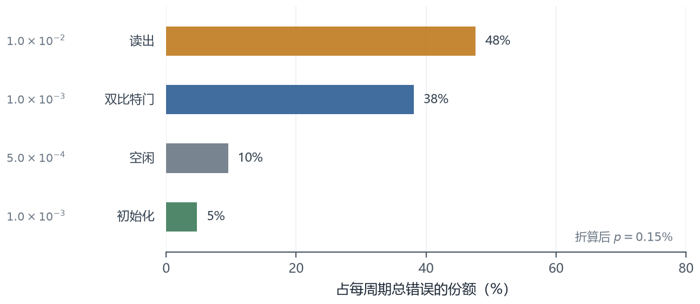
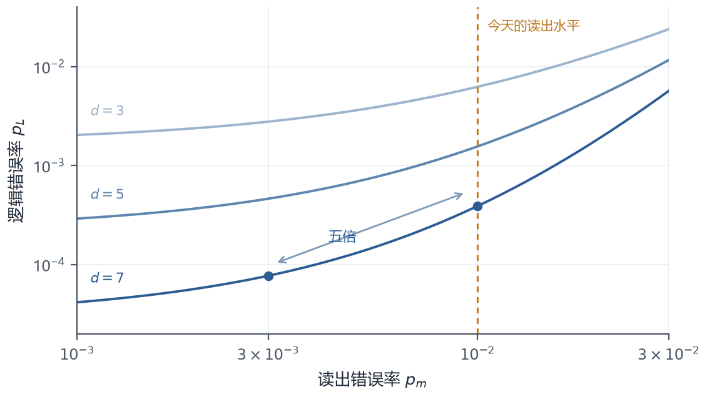

# 第 15 章　一本错误账

一个器件团队会报很多数。$T_1$ 一百微秒，$T_2$ 一百二十微秒，单比特门错误率万分之三，双比特门千分之一，读出百分之一，泄漏每门万分之二。这些数摆在一张表上，看不出哪个最要命。

纠错团队要回答的问题不一样。给定这些数，一台码距多大的机器能跑到 $10^{-12}$，卡在哪一项，改哪一项最划算。回答这个问题要靠一本账，把每一项折成同一种货币，再按码的规律换算成逻辑错误率。这一章讲这本账怎么记。

## 15.1 预算是给谁看的

错误预算这个词借自工程里的功率预算和延迟预算。总目标是一个数，拆到每个零件上，每个零件分到一份额度，谁超了就改谁。

量子这边的总目标是逻辑错误率。算法要跑一亿次门操作，任何一次失败都会毁掉结果，所以目标定在 $10^{-12}$ 以下。这个数要摊到每个物理位置上，摊法由码决定。

预算表有三个用途。设计器件时，它告诉你哪个指标值得砸钱。选码时，它告诉你这个码对哪类错误特别敏感。诊断时，实测的逻辑错误率比预算高出一个数量级，它会告诉你去哪一项找原因。

这三个用途都要求预算表能"逐项拆开"。一个总数没有用，因为总数不能指导行动。

## 15.2 一个位置值多少钱

先把单位统一。表面码的每一个测量周期，每个数据比特被四个相邻的面各碰一次，四次 CNOT。每个测量比特也要发四次 CNOT，另外加一次制备和一次读出。摊到每个比特头上，平均是四个 CNOT，半次制备，半次读出，再加两拍空闲。

把每类操作的错误率记作 $p_2$、$p_m$、$p_{\text{prep}}$、$p_{\text{idle}}$。一周期的总错误是

$$
p_{\text{cycle}}\approx 4p_2+\tfrac12\left(p_{\text{prep}}+p_m\right)+2p_{\text{idle}}
$$

七个操作摊下来，等效的"每个操作"错误率是

$$
p=\frac{1}{7}\left[4p_2+\tfrac12\left(p_{\text{prep}}+p_m\right)+2p_{\text{idle}}\right]
$$

这个 $p$ 才是能拿去和阈值比的量。阈值 0.6% 说的是每个操作的错误率，不是每个周期的。这两者混起来，算出来的码距会差好几倍。

## 15.3 六笔支出

账本上有六行。前四行进上面的式子，后两行单列。

第一行是双比特门。它通常是最大的一项，因为它涉及两个比特的耦合、微波脉冲的校准、能级的精确控制。今天最好的超导器件做到千分之一上下，离子阱也在同一档，只是慢三四个数量级。

第二行是读出。表面码每一轮都要读所有测量比特，读出错误直接变成测量错误。测量错误在时空图里是一条竖直的边，与数据错误引起的水平边形状不同，解码器对它的容忍度也不同。读出做到百分之一已经不错，再往下很难，因为读出时间不能拉长，拉长就和退相干抢时间。

第三行是初始化。制备一个已知态，错误率通常比门低一个数量级，但它在每个周期都发生，累积起来不可忽略。

第四行是空闲。比特没被操作的时候也在退相干，每周期损失的量由 $T_2$ 决定。$T_2$ 一百微秒，周期一微秒，每周期的空闲错误在千分之一量级。这一项常被初学者忘掉，可它在账本上占的份额和初始化差不多。

第五行是泄漏。门操作偶尔把比特打到 $|2\rangle$，这个态不在计算子空间里，稳定子测量对它无效。泄漏不会自己消失，要专门的"泄漏减少"操作定期清理，清理本身又要时间和保真度。泄漏的错误率不高，可它会顺着耦合扩散，一个比特漏了，邻居的测量也跟着错。这一项在账本上最难记，因为它的错误率不是按周期算的，是按"泄漏存活的时长"算的。一个漏了的比特要是在那里躺了五十微秒，它在这段时间里参与的每一次测量都是错的，五十个周期连着错，解码器看到的是一整条竖线，而不是一个点。

第六行是串扰和关联事件。相邻比特的脉冲互相干扰，宇宙射线穿过芯片让一片比特同时失超。前者靠版图和脉冲整形压制，后者没法压，只能靠解码器识别和容忍。这一项在单个比特的测试里看不到，在大方格上却是天花板。

## 15.4 一张账本

拿今天一组有代表性的超导参数填进去。双比特门 $10^{-3}$，初始化 $10^{-3}$，读出 $10^{-2}$，每周期空闲 $5\times10^{-4}$。

图 15-1　一个测量周期里各类操作对总错误的贡献。左列是器件参数，右侧是折算后的份额。四项相加后除以七个操作，得到等效电路级错误率 $0.15\%$

四个数折进去，总量是 $1.05\times10^{-2}$，除以七得到 $1.5\times10^{-3}$，也就是千分之一点五。这个数和这几年公开报道的最好器件在同一档，也解释了为什么那些机器刚好处在阈值附近。

份额的分布值得看。读出占了将近一半，双比特门占四成，空闲占一成，初始化占半成。这个分布说明一件事，想改善逻辑错误率，最该动的是读出。

这个结论与直觉有点冲突。大部分硬件团队把精力放在提高双比特门保真度上，因为门是"量子计算的核心"。可从账本看，读出的权重更大。它每周期的次数只有门的八分之一，错误率却高一个数量级，两相抵消，还是它略占上风。

这也解释了第 10 章那个数字。谷歌 2023 年的抑制因子只有 2.9，理论预期在 5 以上，差的部分主要来自读出。读出错误在时空图里制造假的缺陷对，让解码器做出错误配对。码距越大，方格里的测量比特越多，假缺陷越多，抑制因子越上不去。

## 15.5 哪一笔先还

知道份额还不够，还要知道"改多少能换多少"。

逻辑错误率对物理错误率是指数敏感的，

$$
p_L\propto\left(\frac{p}{p_{th}}\right)^{(d+1)/2}
$$

$p$ 降一成，$d=7$ 时 $p_L$ 降四成多。所以哪怕只把读出从百分之一降到千分之三，$p$ 就从千分之一点五降到千分之一，$p_L$ 降五倍。

图 15-2　固定其他几项，只改读出错误率时逻辑错误率的变化，按 $p_L=0.1(p/p_{th})^{(d+1)/2}$、$p_{th}=0.6\%$ 计算，$p$ 按 15.2 的式子逐项折算。三条曲线对应三个码距，箭头标出 $d=7$ 时读出降到千分之三的收益

图上三条曲线的间距就是码距的收益，码距越大，同一条竖线上下拉得越开。箭头那一小段只跨了不到一个数量级，可它对应的逻辑错误率变化是五倍，因为指数在放大。

反过来看，读出压到千分之三以后，它在总错误里的份额从一半降到两成，再往下压的收益就开始变小。边际收益递减的拐点在哪里，账本上写着。

这也给了一个排序方法。把每一项的"当前份额"乘以"可改善的幅度"，得到该项的潜在收益。读出份额大、可改善空间也大，排第一。双比特门份额大、可改善空间小，排第二。泄漏和串扰份额小，但它们的错误是关联的，解码器对关联错误特别没辙，所以实际权重比份额高。

## 15.6 账本的软肋

这张账算得漂亮，可不能全信。它有几处软的地方，用之前得知道。

第一处是那个比例常数。$p_L=0.1(p/p_{th})^{(d+1)/2}$ 里的 $0.1$ 是从数值模拟里拟合出来的，换一个解码器、换一套版图，它能差三五倍。差三倍意味着同样的 $p$ 下码距要多加二，比特数多一半。所以账本算出来的码距只能当量级看。

第二处是独立性假设。六项是分开算再相加的，这等于假设它们互不相关。真实的器件里，一次宇宙射线会让一片比特同时出错，一次泄漏会让邻近的测量连续错好几轮。这类错误在账本上分不到行，因为它们不属于任何一项。它们的处理方式是单列的，比如"关联事件发生率"，单位是每芯片每秒几次，而不是每个操作多少。

第三处是时间尺度。账本按周期算，可一个逻辑比特要活几十万个周期。在这段时间里，器件的参数会漂移，温度会波动，校准会失效。周期级的错误率和小时级的错误率不是一回事，后者往往高出一个数量级。工程上用"长期稳定性"这个指标来记这笔账，它和任何一项瞬时指标都不对应。

知道这些软处，账本的用途就清楚了。它适合排序，不适合预测。它告诉你读出比门重要，泄漏比初始化危险，关联事件是所有项的公共敌人。它不告诉你某台具体的机器能跑到几个九。

## 15.7 从目标倒推器件

账本还能反着用。给定目标逻辑错误率和可接受的码距，倒推每一项的上限。

要 $p_L=10^{-12}$，$d=27$，阈值 0.6%，代进那条幂律

$$
0.1\left(\frac{p}{0.006}\right)^{14}=10^{-12}
$$

解出 $p\approx9.8\times10^{-4}$。也就是说，等效电路级错误率要从千分之一点五压到千分之一以下。

这个降幅听起来不大，摊到各项上却只够做一件事，把读出从百分之一压到千分之三，门一动不动。总错误预算是 $7p\approx6.9\times10^{-3}$。双比特门占 $4\times10^{-3}$，初始化摊到 $0.5\times10^{-3}$，空闲 $10^{-3}$，剩下给读出的是 $1.4\times10^{-3}$，也就是 $p_m\approx2.8\times10^{-3}$。门可以不动，读出要从百分之一降到千分之三。

反过来，如果读出降不下来，就只能加码距，而码距一加，比特数按平方涨，整机的控制线路也跟着涨。两条路都通，一条靠器件，一条靠面积，选哪条取决于哪一样更便宜。

这张倒推表比正推表更有用，因为它直接给出硬件指标。它也解释了为什么下一代器件的目标都定在"读出千分之三、双比特门千分之一"这个档位，那不是拍脑袋，是从 $10^{-12}$ 和 $d=27$ 反算出来的。

这张表还有一层容易被忽略的约束。它是按"每周期"算的，可算法跑的是"总时间"。总时间越长，累积的错误越多，所以倒推出来的指标其实隐含了一个运行时长的假设。一个跑一秒的算法和一个跑一天的算法，对 $p$ 的要求能差一个数量级。工程师在做资源估算时，会把这个时长乘进去，得到一个"每逻辑操作"的错误率，再和单周期的数分开记。账本的第三列往往就是干这个用的。

数字本身很脆。换一个解码器，换一套版图，常数会变，码距会变，倒推出来的指标也跟着变。但方法不变。一本账，六行，两次换算，一次正推一次倒推，就能把器件的技术路线和算法的资源需求接在一起。

到这一章，这本书讲的东西连成了一条线。信息论的界划出可能，码家族提供工具，手术和工厂提供执行，编译器和解码器提供调度，收尾这本账把一切折算成一个可以比较的数。容错的工程化，说到底就是把这本账算准，然后一行一行去还。
